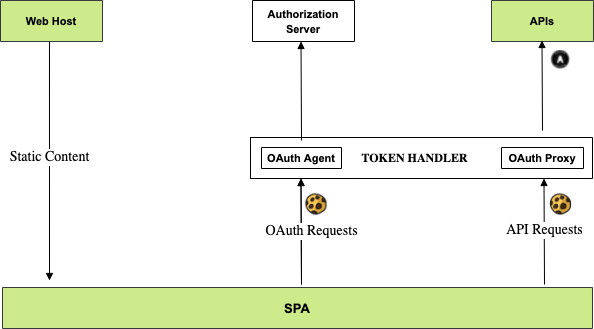

# Cloud Native Token Handler

The token handler provides cookie-secured API entry points for an SPA that run on a BFF domain.  

## Architecture

The token handler runs in cloud native deployments.  
It consists of a utility OAuth Agent API and an OAuth Proxy that runs as an API gateway plugin:



## Local Development Quick Start

The token handler uses a [Real World OAuth Development URL](https://github.com/gary-archer/oauth.blog/blob/master/public/posts/developer-ssl-setup.mdx#real-world-oauth-development-urls) on a local computer.  
You must use admin permissions to configure infrastructure, starting with DNS entries in your `/etc/hosts` file:

```bash
127.0.0.1 localhost bfflocal.authsamples-dev.com
```

Make sure OpenSSL 3+ is installed, specify a secrets folder, then create development certificates:

```bash
export SECRETS_FOLDER="$HOME/secrets"
mkdir -p "$SECRETS_FOLDER"
./certs/create.sh
```

Ensure that Node.js 26+ is installed, then grant it access to listen on port 443:

```bash
sudo setcap 'cap_net_bind_service=+ep' $(which node)
```

## Run the Token Handler

Run the OAuth Agent utility API, with an API gateway that runs the OAuth Proxy plugin:

```bash
npm start
```

## Test the Token Handler

Install a UI test framework that can do browser logins:

```bash
npx playwright install-deps
npx playwright install
```

Then run the following command to call endpoints and test the cookie lifecycle:

```bash
npm test
```

Then run `docker compose down` to free resources.

## Deploy the Token Handler

Deploy the token handler to Docker with the following commands:

```bash
./docker/build.sh
./docker/deploy.sh
./docker/teardown.sh
```

## API Performance

The token handler has minimal impact on the performance of API requests:

- The SPA makes OAuth requests to the OAuth Agent via the API gateway.
- The SPA makes API requests via the API gateway, which runs the OAuth Proxy plugin.
